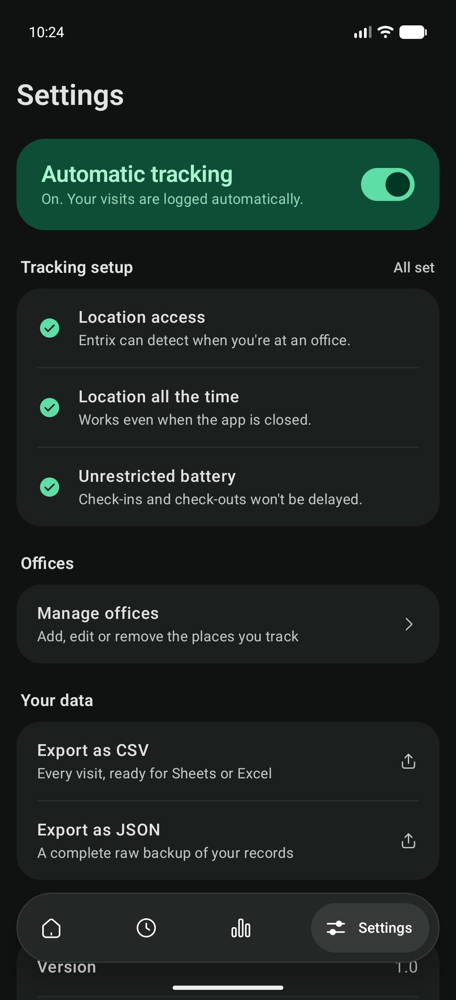
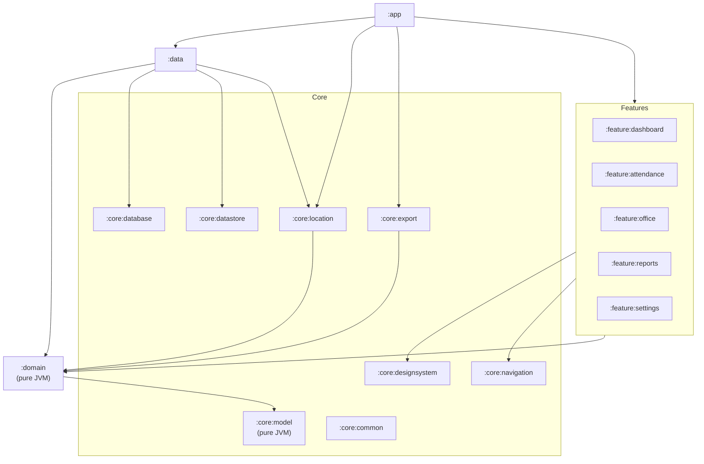

# Entrix

**Automatic Place & Attendance Tracker**

Entrix is a privacy-first Android app that automatically records when you enter and leave your offices using the Android Geofencing API — then turns those visits into history, reports and shareable PDF timesheets. No account, no cloud, no analytics, no ads. Everything stays on the device.

[](https://github.com/Nahian98/Entrix-pro/actions/workflows/ci.yml)


> 🧪 Portfolio project. Functionally complete, release-hardened (R8 + resource shrinking + signing config) and CI-gated — see the [Roadmap](#roadmap) for what's next.

---

## Why it exists

Most attendance apps want a login, a server, and your data. Entrix is the opposite: a small, polished, **offline-first** tool that quietly logs your office hours on-device. It doubles as a demonstration of production-grade, modern Android engineering — clean architecture, strict modularization, convention-plugin Gradle, and a fully unit-tested domain layer.

## Features

- 📍 Track **multiple offices**, each with its own location and geofence radius
- 🟢 Automatic, battery-friendly **entry / exit detection** via geofencing (no continuous polling, no foreground service)
- 🕓 Local attendance history, grouped by day and labelled per office
- 📊 **Weekly & monthly reports** — totals, days present, per-office breakdown, a bar chart, and trend vs. the previous period
- 📄 **Export timesheets to PDF** and share them — generated on-device, no third-party libraries
- 🗑️ Delete an office without losing its data — offices are **archived**, so past history and timesheets stay intact
- 🔒 100% local — no account, no network, no tracking
- 🎨 Material 3 UI with dynamic color, light/dark themes
- 🔁 Geofences automatically restored after device reboot

## Screenshots

Material 3 UI with full light & dark theme support (and Material You dynamic color).

| Dashboard | History | Settings |
|:---:|:---:|:---:|
|  |  |  |
|  |  |  |

---

## Architecture

Entrix follows **Clean Architecture** with **MVVM** and **unidirectional data flow**, split into a feature-first multi-module structure. Dependencies always point inward: features and data depend on the domain; the domain depends on nothing Android.



Key rule: **`:domain` and `:core:model` are pure Kotlin/JVM modules** — they cannot even compile against the Android SDK. Business logic is therefore unit-testable with plain JUnit, no Robolectric or emulator required.

### Module responsibilities

| Module | Type | Responsibility |
|---|---|---|
| `:app` | app | Application, Koin start-up, navigation host, theme entry, composition root |
| `:feature:dashboard` | android-lib | Per-office status + today's totals |
| `:feature:attendance` | android-lib | History list, grouped by day and labelled per office; delete |
| `:feature:office` | android-lib | Manage offices — list, add/edit, archive (location + radius) |
| `:feature:reports` | android-lib | Weekly/monthly reports, bar chart, PDF export |
| `:feature:settings` | android-lib | Tracking toggle, permissions, battery, about |
| `:domain` | **JVM** | Entities-adjacent models, repository interfaces, use cases |
| `:data` | android-lib | Repository implementations, entity↔model mappers, DI |
| `:core:model` | **JVM** | Shared domain models (`Office`, `Attendance`, …) |
| `:core:common` | android-lib | Dispatchers, `AppResult`, shared utilities |
| `:core:designsystem` | android-lib | Theme, spacing, reusable Compose components (incl. bar chart) |
| `:core:navigation` | android-lib | Type-safe navigation routes |
| `:core:database` | android-lib | Room database, DAOs, entities (schema exported, migrated) |
| `:core:datastore` | android-lib | Preferences DataStore |
| `:core:location` | android-lib | Geofencing client, broadcast receivers, fused location |
| `:core:export` | android-lib | Offline PDF timesheet rendering (framework `PdfDocument`) |

---

## Tech stack

| Concern | Choice |
|---|---|
| Language | Kotlin (coroutines, `StateFlow`) |
| UI | Jetpack Compose, Material 3, Navigation Compose (type-safe) |
| DI | **Koin** |
| Persistence | Room (single source of truth, versioned migrations) + DataStore |
| Location | Android Geofencing API + Fused Location Provider |
| Reporting | On-device PDF via `android.graphics.pdf.PdfDocument`, shared through `FileProvider` |
| Build | Gradle Kotlin DSL, Version Catalog, **`build-logic` convention plugins** |
| Testing | JUnit, Coroutines Test, Turbine, MockK, Room `MigrationTestHelper` |

### Engineering highlights

- **Convention plugins (`build-logic/`)** — every module's build script is a few lines; shared config (`compileSdk`, Compose, Room, feature wiring) lives in `entrix.android.*` / `entrix.jvm.library` plugins. No copy-pasted Gradle.
- **Pure-JVM domain** — framework independence enforced by the module boundary, not just convention.
- **Single source of truth** — Room exposes `Flow`; the UI derives immutable state from it.
- **Privacy by construction** — no networking dependency exists anywhere in the graph.

---

## How geofencing works

Entrix never polls location. It registers one geofence per configured office and reacts to OS-delivered transitions. To stay accurate **and** avoid logging drive-bys or GPS jitter at the boundary, it uses a deliberate reconciliation policy (`RecordGeofenceTransitionUseCase`):

```
ENTER  →  cache the precise crossing time (persisted per office, survives process death)
DWELL  →  open a visit, back-dated to the cached ENTER time
EXIT   →  close the open visit; discard any unconfirmed ENTER
```

A visit is only created once the user has **dwelled** (~2 min) inside the region — so a brief pass near the boundary leaves no record — yet `enterTime` is still the real moment of entry because the ENTER timestamp was cached. The pending ENTER is tracked **per office**, so simultaneous visits to different offices never interfere. Every branch is idempotent, so duplicate transitions can't corrupt state. This logic is covered by unit tests.

Geofences are re-registered on boot, transitions are handled in a `BroadcastReceiver` via `goAsync()` (no foreground service), and Google Play Services availability and permission revocation are handled gracefully.

> **Note on the location picker:** the office is selected via *"use my current location"* + editable coordinates + a radius slider, behind an abstraction. A Google Maps SDK picker can be slotted in without touching the domain or data layers — it was kept optional to keep the app free of a billing-gated API key and true to its zero-cloud ethos.

---

## Building

Requirements: **JDK 17+** (the build targets Java 17; Android Studio's bundled JBR 21 works) and the Android SDK.

```bash
# Point JAVA_HOME at a JDK 17+ (e.g. Android Studio's JBR), then:
./gradlew assembleDebug          # build the debug APK
./gradlew :domain:test           # run the pure-JVM domain tests
./gradlew testDebugUnitTest      # run all JVM unit tests
./gradlew installDebug           # install on a connected device/emulator
```

No API keys or `local.properties` secrets are required to build or run.

## Testing

- **54 JVM unit tests** across the domain, data and feature modules — including full coverage of the geofence reconciliation policy, multi-office dashboard/report aggregation, PDF timesheet assembly, office validation, ViewModels, and persistence mappers.
- **Instrumented Room tests** — DAO open/close + foreign-key cascade, and a **v1→v2 migration test** verifying the `archived` column is added without losing data — run on a device with `./gradlew connectedDebugAndroidTest`.
- Room validates all DAO SQL **at compile time** via KSP; the schema is exported to `core/database/schemas/` and migrations are tested against it.
- A `KoinGraphTest` statically `verify()`s the full DI graph, catching missing bindings at build time.

---

## Roadmap

Delivered:

- [x] Multiple offices
- [x] Reports & statistics (weekly/monthly, per-office breakdown, trend)
- [x] PDF timesheet export
- [x] Release hardening (R8/minify, resource shrinking, ProGuard rules, release signing)
- [x] CI (GitHub Actions: build + tests + lint) and a Koin graph `verify()` check
- [x] Screenshots (light & dark)

Planned:

- [ ] Optional Google Maps picker
- [ ] Future ideas (kept architecturally open): home-screen widgets, backup/restore, Wear OS, localization

## License

MIT — see `LICENSE`. (Add a `LICENSE` file if one isn't present yet.)
