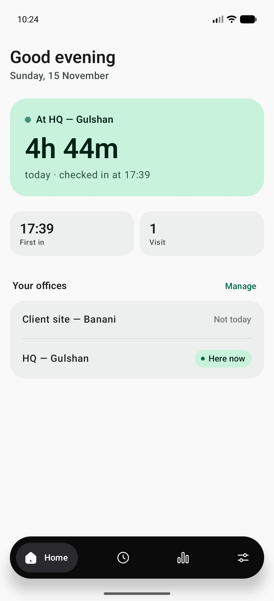
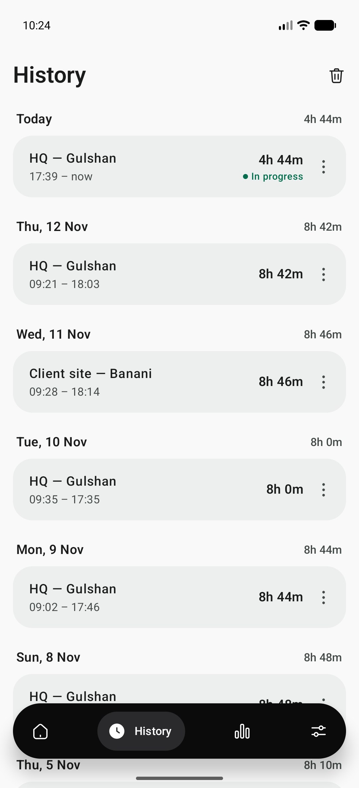
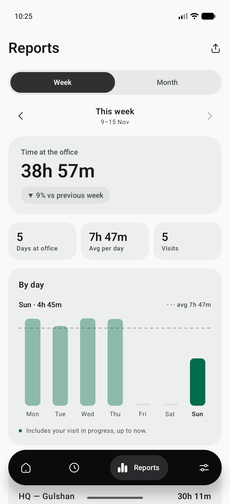
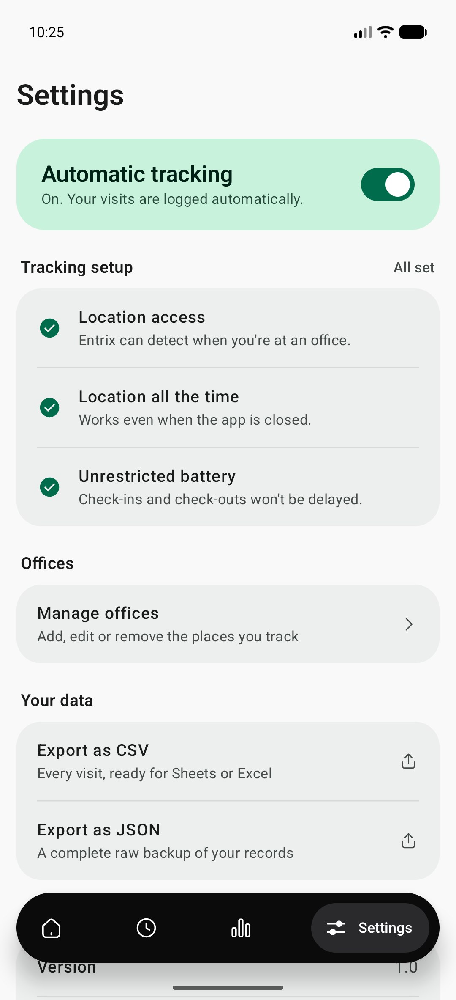
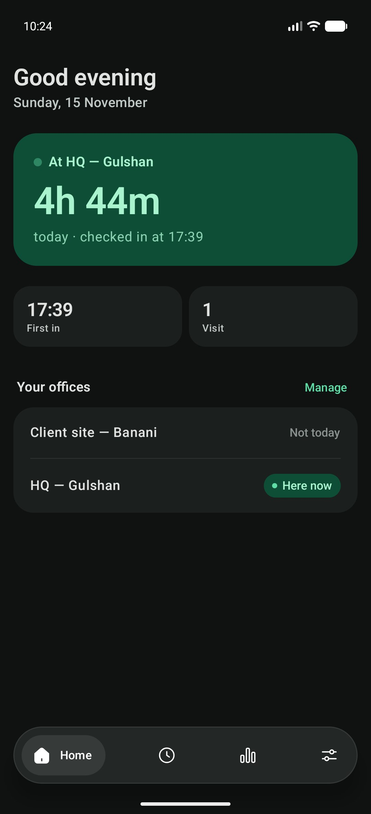
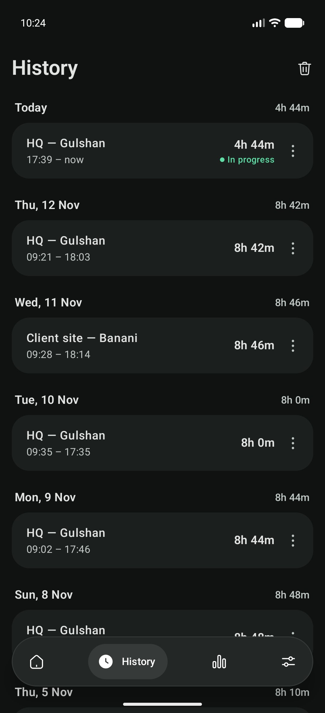
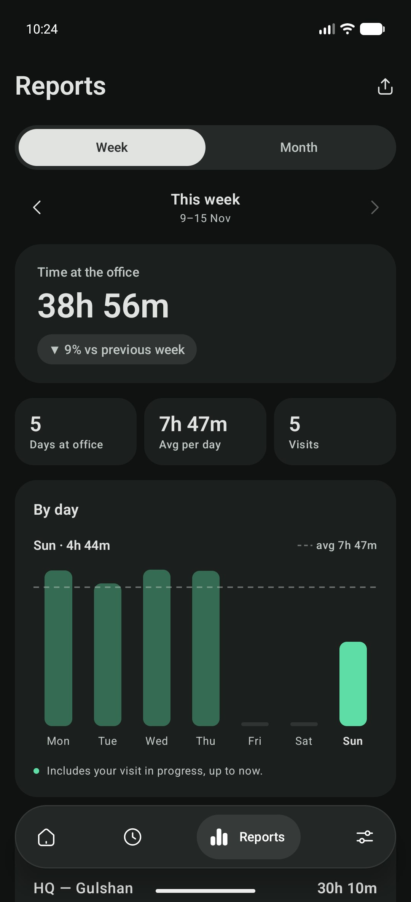
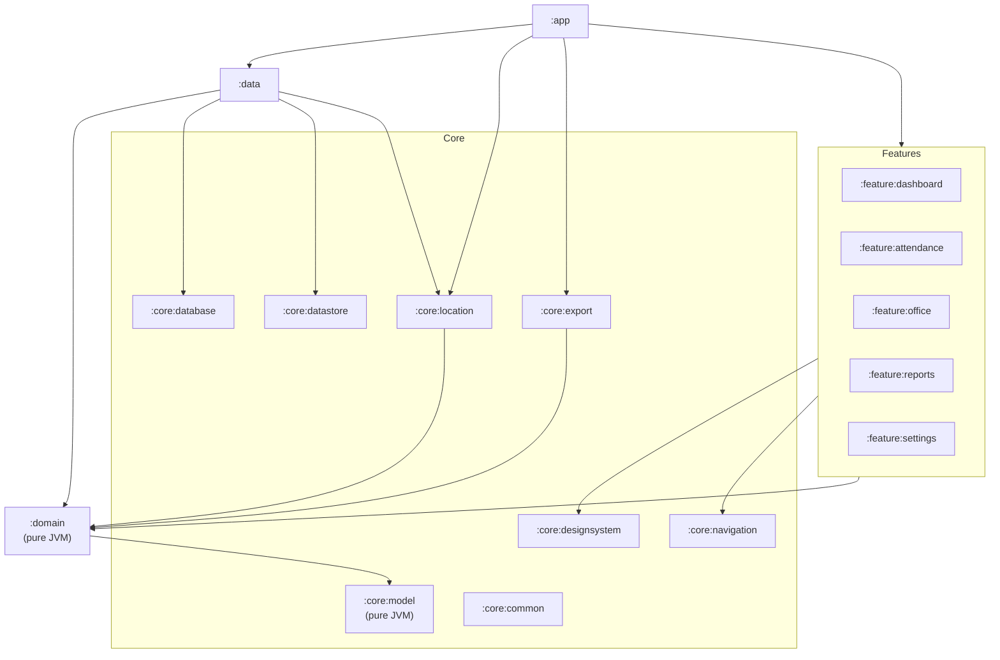

# Entrix

**Automatic Place & Attendance Tracker**

Entrix is a privacy-first Android app that automatically records when you enter and leave your offices using the Android Geofencing API — then turns those visits into history, reports and shareable PDF timesheets. No account, no analytics, no ads, and your attendance data never leaves the device. The only online touchpoint is the optional Google Maps picker used when setting up an office.

[](https://github.com/Nahian98/Entrix/actions/workflows/ci.yml)


> 🧪 Portfolio project. Functionally complete, release-hardened (R8 + resource shrinking + signing config) and CI-gated — see the [Roadmap](#roadmap) for what's next.

---

## Why it exists

Most attendance apps want a login, a server, and your data. Entrix is the opposite: a small, polished, **offline-first** tool that quietly logs your office hours on-device. It doubles as a demonstration of production-grade, modern Android engineering — clean architecture, strict modularization, convention-plugin Gradle, and a fully unit-tested domain layer.

## Features

- 📍 Track **multiple offices**, each with its own location and geofence radius
- 🗺️ **Map location picker** — search an address or tap the map to drop a pin and size the geofence, with a full-screen map for fine-tuning (Google Maps)
- 🟢 Automatic, battery-friendly **entry / exit detection** via geofencing (no continuous polling, no foreground service), hardened against GPS jitter and false exits
- 🏠 **Live home screen** — where you are right now and today's time so far, ticking every minute, plus a clear warning (and one-tap fix) when tracking is paused
- 🕓 **History** grouped by day ("Today", "Yesterday", …) with a total per day; a visit in progress counts up live
- 📊 **Weekly & monthly reports** — total with trend vs. the previous period, days at office, average per day, an interactive bar chart (tap a day, dashed average line), and per-office share of time
- ✅ **Tracking setup checklist** in Settings — shows exactly which permission or battery setting is holding tracking back, and why it matters
- 📄 **Export timesheets to PDF** and share them — generated on-device, no third-party libraries
- 🗑️ Delete an office without losing its data — offices are **archived**, so past history and timesheets stay intact
- 🔒 Private by default — no account, no analytics, no ads; attendance data never leaves the device
- 🎨 Material 3 UI with a custom emerald palette tuned separately for light and dark, a floating navigation bar and a custom icon set
- 🔁 Geofences automatically restored after device reboot

## Screenshots

Material 3 UI with a custom emerald palette in light & dark, a floating pill navigation bar and collapsing headers. (Sample data.)

| Home | History | Reports | Settings |
|:---:|:---:|:---:|:---:|
|  |  |  |  |
|  |  |  |  |

---

## Architecture

Entrix follows **Clean Architecture** with **MVVM** and **unidirectional data flow**, split into a feature-first multi-module structure. Dependencies always point inward: features and data depend on the domain; the domain depends on nothing Android.



Key rule: **`:domain` and `:core:model` are pure Kotlin/JVM modules** — they cannot even compile against the Android SDK. Business logic is therefore unit-testable with plain JUnit, no Robolectric or emulator required.

### Module responsibilities

| Module | Type | Responsibility |
|---|---|---|
| `:app` | app | Application, Koin start-up, navigation host, app shell (floating nav bar, per-screen headers), composition root |
| `:feature:dashboard` | android-lib | Home: live status card, today's facts, per-office presence, first-run welcome |
| `:feature:attendance` | android-lib | History grouped by day with day totals and live open visits; delete |
| `:feature:office` | android-lib | Manage offices — list, add/edit (map picker + search), archive |
| `:feature:reports` | android-lib | Weekly/monthly reports, interactive bar chart, office shares, PDF export |
| `:feature:settings` | android-lib | Tracking main switch, setup checklist (permissions, battery), data export, about |
| `:domain` | **JVM** | Entities-adjacent models, repository interfaces, use cases, minute ticker for live values |
| `:data` | android-lib | Repository implementations, entity↔model mappers, DI |
| `:core:model` | **JVM** | Shared domain models (`Office`, `Attendance`, …) |
| `:core:common` | android-lib | Dispatchers, `AppResult`, shared utilities |
| `:core:designsystem` | android-lib | Emerald theme, spacing, custom icon set, reusable components (nav bar, collapsing header, bar chart, stat tile, toggle) |
| `:core:navigation` | android-lib | Type-safe navigation routes |
| `:core:database` | android-lib | Room database, DAOs, entities (schema exported, migrated) |
| `:core:datastore` | android-lib | Preferences DataStore |
| `:core:location` | android-lib | Geofencing, broadcast receivers, fused location, location search (Geocoding) |
| `:core:export` | android-lib | Offline PDF timesheet rendering (framework `PdfDocument`) |

---

## Tech stack

| Concern | Choice |
|---|---|
| Language | Kotlin (coroutines, `StateFlow`) |
| UI | Jetpack Compose, Material 3, Navigation Compose (type-safe) |
| DI | **Koin** |
| Persistence | Room (single source of truth, versioned migrations) + DataStore |
| Location | Android Geofencing API + Fused Location Provider |
| Maps & search | Maps SDK for Android (`maps-compose`) + Google Geocoding web service |
| Reporting | On-device PDF via `android.graphics.pdf.PdfDocument`, shared through `FileProvider` |
| Build | Gradle Kotlin DSL, Version Catalog, **`build-logic` convention plugins** |
| Testing | JUnit, Coroutines Test, Turbine, MockK, Room `MigrationTestHelper` |

### Engineering highlights

- **Convention plugins (`build-logic/`)** — every module's build script is a few lines; shared config (`compileSdk`, Compose, Room, feature wiring) lives in `entrix.android.*` / `entrix.jvm.library` plugins. No copy-pasted Gradle.
- **Pure-JVM domain** — framework independence enforced by the module boundary, not just convention.
- **Single source of truth** — Room exposes `Flow`; the UI derives immutable state from it.
- **Privacy by default** — attendance data never leaves the device; the only network use is the Google Maps picker and geocoding search at office setup, isolated in `:core:location`.

---

## How geofencing works

Entrix never polls location. It registers one geofence per configured office and reacts to OS-delivered transitions. To stay accurate **and** avoid logging drive-bys or GPS jitter at the boundary, it uses a deliberate reconciliation policy (`RecordGeofenceTransitionUseCase`):

```
ENTER  →  cache the precise crossing time (persisted per office, survives process death)
DWELL  →  open a visit, back-dated to the cached ENTER time
EXIT   →  close the open visit; discard any unconfirmed ENTER
ENTER/DWELL within 10 min of a check-out  →  reopen that visit instead (exit grace period)
```

A visit is only created once the user has **dwelled** (~2 min) inside the region — so a brief pass near the boundary leaves no record — yet `enterTime` is still the real moment of entry because the ENTER timestamp was cached. The pending ENTER is tracked **per office**, so simultaneous visits to different offices never interfere. Every branch is idempotent, so duplicate transitions can't corrupt state. This logic is covered by unit tests.

Exits get the same protection: indoors, a single coarse network fix (often requested by *another* app) can land outside the circle and fire a false EXIT followed moments later by an ENTER. Rather than leaving the user "checked out" while still inside, a re-entry within the **10-minute grace period** reopens the visit with its original entry time; a real departure is unaffected because nobody re-enters within minutes. Separately, a visit left open for 16 hours (a genuinely missed EXIT) is capped and flagged for review rather than growing into a multi-day "visit".

Geofences are re-registered on boot, transitions are handled in a `BroadcastReceiver` via `goAsync()` (no foreground service), and Google Play Services availability and permission revocation are handled gracefully.

> **Location picker:** offices are placed on an interactive **Google Map** — search an address (Geocoding, region-biased) or tap to drop the pin, with the geofence shown as a radius circle and a full-screen map for fine-tuning. It sits behind a domain abstraction (`LocationSearcher`), so the `:domain`/`:data` layers never see the Maps SDK; "use my current location" + manual coordinate entry remain as the offline fallback. The Maps API key is read from a git-ignored `local.properties` and never committed.

---

## Building

Requirements: **JDK 17+** (the build targets Java 17; Android Studio's bundled JBR 21 works) and the Android SDK.

```bash
# Point JAVA_HOME at a JDK 17+ (e.g. Android Studio's JBR), then:
./gradlew assembleDebug          # build the debug APK
./gradlew :domain:test           # run the pure-JVM domain tests
./gradlew testDebugUnitTest      # run all JVM unit tests
./gradlew installDebug           # install on a connected device/emulator
```

The project builds with **no secrets** — without a Maps key the app runs fine and the picker map just renders blank. To enable the map picker, add your key to `local.properties` (git-ignored):

```
MAPS_API_KEY=AIza...
```

The key needs the **Maps SDK for Android** and **Geocoding API** enabled and added to its restrictions (both within Google's free tier). Restrict it to your package + signing SHA-1.

## Testing

- **93 JVM unit tests** across the domain, data and feature modules — including the geofence reconciliation policy and exit grace period, live "time so far" ticking (driven by an injected `Clock` and virtual time), multi-office dashboard/history/report aggregation, PDF timesheet assembly, office validation & location search, ViewModels, and persistence mappers.
- **Instrumented Room tests** — DAO open/close/reopen + foreign-key cascade, and a **v1→v2 migration test** verifying the `archived` column is added without losing data — run on a device with `./gradlew connectedDebugAndroidTest`.
- Room validates all DAO SQL **at compile time** via KSP; the schema is exported to `core/database/schemas/` and migrations are tested against it.
- A `KoinGraphTest` statically `verify()`s the full DI graph, catching missing bindings at build time.

---

## Roadmap

Delivered:

- [x] Multiple offices
- [x] Reports & statistics (weekly/monthly, per-office breakdown, trend)
- [x] PDF timesheet export
- [x] Release hardening (R8/minify, resource shrinking, ProGuard rules, release signing)
- [x] CI (GitHub Actions: build + tests + lint) and a Koin graph `verify()` check
- [x] Screenshots (light & dark)
- [x] Map location picker with address search
- [x] UI redesign — live home screen, day-grouped history, interactive reports, setup checklist, emerald palette
- [x] Exit grace period against false check-outs (verified on a real device)

Planned:

- [ ] Google Places type-ahead autocomplete (nicer search; metered API)
- [ ] Future ideas (kept architecturally open): home-screen widgets, backup/restore, Wear OS, localization

## License

MIT — see [`LICENSE`](LICENSE).
